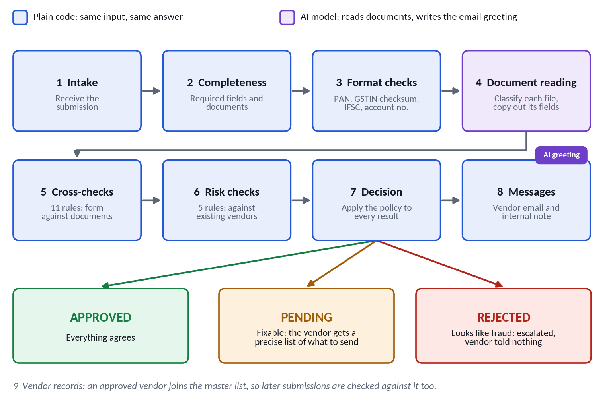
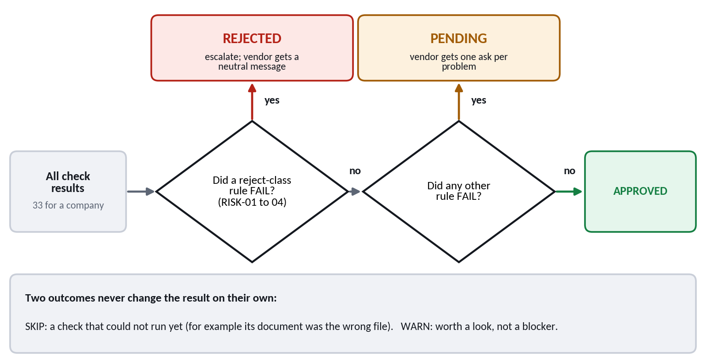
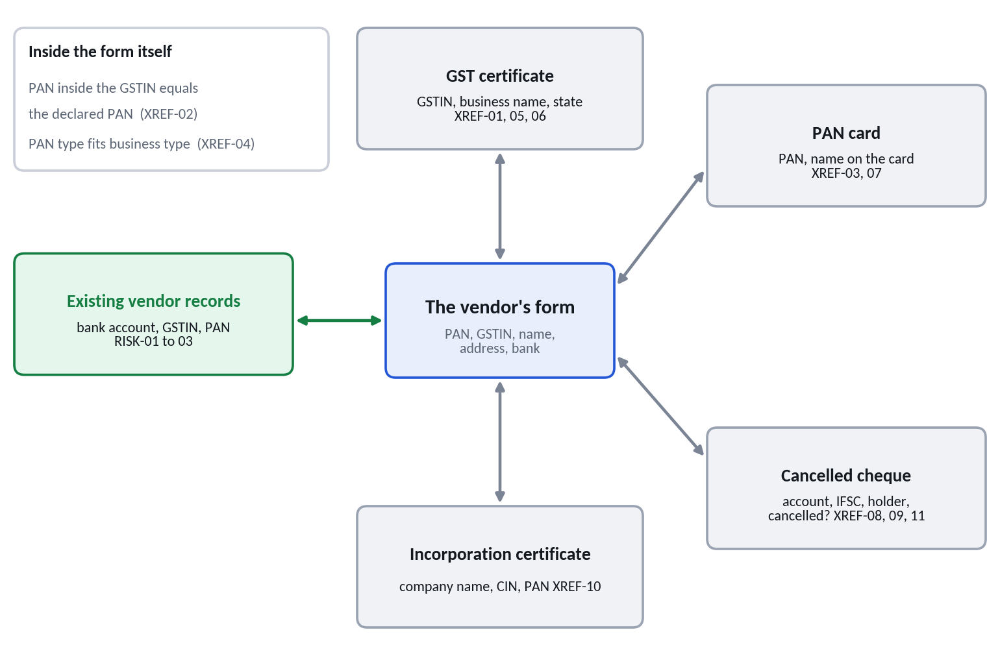
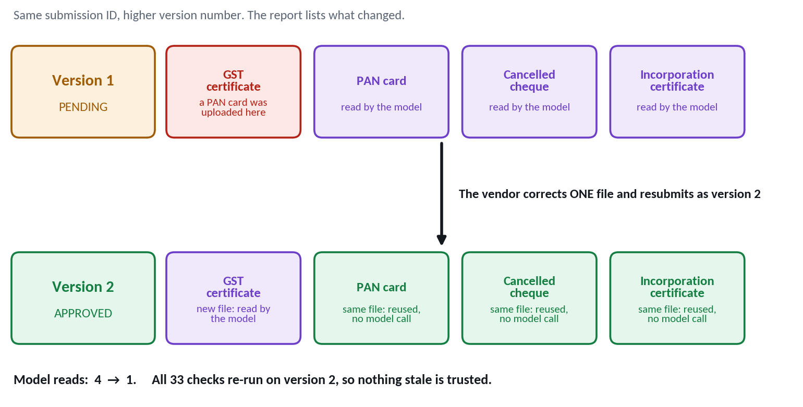

# Vendor Onboarding

**Turn a vendor's form and documents into an explainable decision: approved, pending or rejected. Then write back to the vendor.**

**Live demo: https://vendor-onboarding-oh3u.onrender.com/**
(Free hosting sleeps when idle, so the first load after a quiet period can take up to a minute.)

Built as a take-home case study on vendor onboarding. Before a company can pay a new vendor, someone has to check that the vendor is real: that the paperwork is complete, consistent and credible. This project automates that check end to end, and shows its reasoning at every step.

> **The idea in one line:** the AI reads, the code decides, and every verdict cites a rule.

## Try it in a minute

1. Open the [live demo](https://vendor-onboarding-oh3u.onrender.com/).
2. On the **Run** page, pick **Nexora Tech Supplies** and click **Run process**.
3. Watch each stage execute. Every document is valid, yet the vendor is **rejected**: its bank account already belongs to an existing vendor. Open the *Email to vendor* and *Internal note* tabs to see what each side is told.
4. Open the **Dashboard** to see the run recorded with its full reasoning.

## What it does

A vendor submits a form and three or four documents (GST certificate, PAN card, cancelled cheque, and an incorporation certificate for companies). The process returns one of three outcomes:

| Outcome | Meaning | The vendor receives | Procurement receives |
|---|---|---|---|
| **APPROVED** | Everything agrees. | A welcome email. | An internal note, and the full list of checks on the dashboard. |
| **PENDING** | Something is missing or fixable. | A precise list of what to send. | The same list, with the rule behind each item. |
| **REJECTED** | The details contradict each other in a way that looks like fraud. | A neutral message with no reasons. | The full reasoning and a "do not onboard" note. |

## How it works



Documents are read by a vision model. Everything after that is plain code, so the same input always gives the same answer.

| Stage | What happens |
|---|---|
| Intake and completeness | Required fields and documents for the business type are present. |
| Format checks | PAN, GSTIN (including its official checksum), IFSC and account number are well-formed. |
| Document reading | Each file is classified and its fields are copied out. A PDF with selectable text is read as text; a scan or photo is read as an image. The model never sees the form, so it cannot be nudged to agree with it. Anything unreadable is left blank, never guessed. |
| Cross-checks | Eleven rules compare the form with the documents, and the documents with each other. |
| Risk checks | Five rules compare the submission with existing vendors and look for suspicious patterns. |
| Decision | A fixed policy turns every rule result into an outcome. |
| Messages | A vendor email and an internal note. |

### The decision policy



- A failure in a **reject-class** rule (`RISK-01` to `RISK-04`) means **REJECTED**.
- Any other failure means **PENDING**, with one plain-English ask per problem.
- A check that cannot run yet (for example, its document was the wrong file) is **skipped, not failed**, so the vendor gets one precise ask and not five complaints.
- Warnings are listed but never block.

### What gets compared with what



There are **33 checks** for a company and **31** for a sole proprietor (who has no incorporation certificate):

| Stage | Checks | Examples |
|---|---|---|
| Completeness | 3 | Business type is recognised; required fields and documents are present. |
| Format | 6 | GSTIN structure, state code and checksum; PAN, IFSC and account number format. |
| Documents | 2 per document | It is the right document for its slot; the needed fields were readable. |
| Cross-checks | 11 | GSTIN and PAN agree across form and certificates; the PAN inside the GSTIN matches; GSTIN state matches the address; names agree; bank details match the cheque. |
| Risk | 5 | Bank account, GSTIN or PAN already used by another vendor; a pattern of unrelated inconsistencies; a free email address on a company. |

## The edge cases

| Case | Situation | Outcome | Decided by |
|---|---|---|---|
| Trade name vs owner name | The cheque is in the owner's name, the form shows the trade name. A naive check rejects an honest business. | APPROVED | `XREF-08`: the GST certificate links the trade name to the owner, and the PAN is an individual's. A company never gets this exception. |
| Reused bank account | Every document is valid on its own, but the bank account already belongs to an existing vendor. | REJECTED | `RISK-01` |
| GST state mismatch | A Karnataka GSTIN with a Maharashtra address. Not fraud: businesses hold one GSTIN per state. | PENDING | `XREF-05`, with an ask for the Maharashtra GSTIN or a confirmed billing address |
| Wrong document, then the fix | A PAN card is uploaded as the GST certificate; the vendor then sends the right file. | PENDING, then APPROVED | `DOC-01`; dependent checks are skipped, then re-run in version 2 |

### The resubmission loop



A resubmission keeps its submission ID with a higher version number. **All checks re-run**, so nothing stale is trusted. A file that is byte-for-byte identical to the previous version is not sent to the model again, so a one-file correction costs one model call, not four. The result lists exactly what changed.

## Features

- **Live run view.** Stages light up as they execute, with real timings, each check as it is evaluated, and "model busy, retrying" notices.
- **Dashboard.** Every run with filters and search; open any run to see its checks, documents and what was read from them, both messages, and what changed since the previous version.
- **Custom submissions.** Start from a built-in case or a blank form, edit any field, and replace any file. Resubmit any run with changes.
- **Audit trail.** Every run is stored with its full result.
- **A growing vendor list.** Vendors approved by the process join the records, so a later submission that reuses their bank account is caught.
- **Resilience.** The model reader retries with waits, can fall back to a second model, can cache results, and turns every failure into a plain-English message.
- **Safe uploads.** File type is read from the content, size is capped, files are stored under random IDs, and runs are rate-limited.

## Quick start

**Requirements:** Python 3.10 or newer, and a free [Gemini API key](https://aistudio.google.com/app/api-keys).

```bash
python3 -m venv .venv
source .venv/bin/activate          # Windows: .venv\Scripts\activate
pip install -r requirements.txt

cp .env.example .env               # then put your key in GEMINI_API_KEY
python -m app.check_models --apply # picks models that are answering right now

uvicorn app.server:app --reload    # open http://127.0.0.1:8000
```

Run it from the command line instead:

```bash
python -m app.run_pipeline test_cases/04_gst_state_mismatch   # one case, with email and internal note
python -m app.run_pipeline --all --reset                      # all six cases, with a scoreboard
python -m app.run_pipeline --demo-resubmission                # wrong document, then the fix
python -m app.history                                         # every recorded run
python -m app.history SUB-1005                                # all versions of one submission
```

## Test cases

All documents and companies are **fictitious specimens**, watermarked "SPECIMEN". GSTIN values carry real checksums, so they pass format validation.

| Folder | Vendor | Expected outcome |
|---|---|---|
| `01_happy_path` | Kavya Packaging Solutions Pvt Ltd | APPROVED |
| `02_trade_name_vs_legal_name` | Sharma Electricals | APPROVED |
| `03_bank_account_reused` | Nexora Tech Supplies Pvt Ltd | REJECTED |
| `04_gst_state_mismatch` | Deccan Logistics LLP | PENDING |
| `05a_wrong_document` | Greenleaf Facility Services Pvt Ltd | PENDING |
| `05b_wrong_document_resubmitted` | Greenleaf Facility Services Pvt Ltd | APPROVED |

The inputs mix a normal PDF, a scanned PDF with no text layer, and tilted phone photos. `python scripts/build_test_data.py` regenerates them. The expected outcomes live in `test_cases/manifest.json`, which only the scoreboard reads, never the pipeline.

## Configuration

Settings come from environment variables, or from a `.env` file locally.

| Variable | Purpose | Default |
|---|---|---|
| `LLM_PROVIDER` | `gemini` (free tier) or `anthropic` (paid, optional) | `gemini` |
| `GEMINI_API_KEY` | Key for the document-reading model | none |
| `GEMINI_MODEL` | Main model. Run `python -m app.check_models` to see what works | built-in default |
| `GEMINI_FALLBACK_MODEL` | Second model, tried if the first stays busy | none |
| `EXTRACTION_CACHE` | `1` saves each reading on disk, so repeat runs are instant and free | `0` |
| `RUNS_PER_HOUR` | Per-visitor run limit | `40` |
| `MAX_CONCURRENT_RUNS` | Runs allowed at the same time | `3` |
| `MAX_UPLOAD_MB` | Largest accepted upload | `8` |
| `ADMIN_TOKEN` | Enables `POST /api/admin/reset` (history reset), when set | disabled |

## API

| Endpoint | Purpose |
|---|---|
| `POST /api/run` | Run a submission and stream every stage as server-sent events |
| `POST /api/uploads` | Create a submission from a form and files, optionally starting from an earlier one |
| `GET /api/runs`, `GET /api/runs/{id}` | Run history and a full run |
| `GET /api/submissions/{id}` | All versions of a submission, with what changed |
| `GET /api/cases` | The built-in test cases |
| `GET /health` | Health check |

## Project structure

```
app/
  pipeline.py        the whole process, stage by stage
  documents.py       triage, reading and verifying each file
  llm.py             the only place the model is called (Gemini, optional Claude)
  validators.py      PAN, GSTIN (with checksum) and IFSC checks
  completeness.py    required fields and documents by business type
  crossref.py        the 11 cross-checks
  risk.py            the 5 risk checks
  names.py           deterministic name matching
  decision.py        the decision policy and the vendor-safe asks
  messages.py        vendor email and internal note
  changes.py         what changed between two versions
  store.py           run history and approved vendors (SQLite)
  server.py          FastAPI app: streaming runs, uploads, history
  run_pipeline.py    command-line runner (also history.py, check_models.py)
  static/index.html  the run view and dashboard (one page, no build step)
data/                existing-vendor records
scripts/             test-data generator, extraction checker
test_cases/          six cases with specimen documents
tests/               unit and API tests, plus an optional browser-level test
```

## Tests

```bash
python -m pytest -q
```

The suite needs no API key or network: it covers the rules, decision policy, messages, name matching, the resubmission loop, the web API and upload safety. An optional browser-level test (needs Node) drives the real page against a live server; see `tests/e2e/`.

## Deploying

The repository includes a [Render](https://render.com) Blueprint (`render.yaml`):

1. Push to GitHub.
2. In Render: **New, then Blueprint**, and choose the repository.
3. Enter `GEMINI_API_KEY`, `GEMINI_MODEL` and `GEMINI_FALLBACK_MODEL` when asked.

On Render's free tier a service sleeps after about 15 idle minutes and its local files, including the run history, are lost on restart. A free uptime monitor pointed at `/health` keeps it awake.

## Assumptions and limitations

- **Indian vendors only.** The identifiers are PAN, GSTIN and IFSC. Other countries would need their own validators behind the same pipeline.
- **No live lookups.** The GSTIN is checked for structure and checksum, not against the government registry; the bank account is checked against the cheque, not with the bank.
- **Specimen data only.** Real documents vary far more in layout and quality. Free model tiers may use submitted content to improve their products, so do not upload real documents.
- **A free model can be busy.** The reader retries and can fall back to a second model, but cannot make the provider available.
- **History is temporary** on free hosting. A production system would use a managed database.

Full scope, the meaning of each outcome, the rule ID scheme and the reasoning behind each choice are in [ASSUMPTIONS.md](ASSUMPTIONS.md).

## What would come next

1. Live GST registry lookup to confirm a GSTIN is active.
2. Bank penny-drop verification, replacing reliance on a photographed cheque.
3. Document expiry and tampering signals.
4. Foreign vendors (VAT or EIN, IBAN or SWIFT) behind the same pipeline.
5. A human review queue with recorded overrides.
6. Email in and out, so a vendor's reply re-triggers the check.

## Notes

Built with AI assistance (Claude) for code and review, as the case study encourages. Every design decision is documented in [ASSUMPTIONS.md](ASSUMPTIONS.md).
